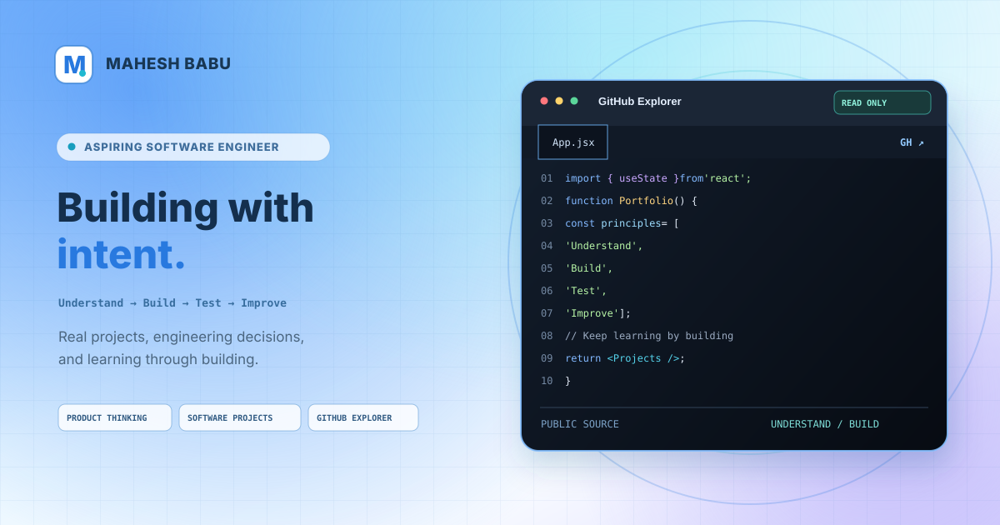

# Mahesh Babu — Portfolio 🚀



A responsive personal portfolio showcasing my **engineering journey, selected projects, and practical approach to software development**, built with React and Vite.

> **Understand → Build → Test → Improve**

> 🛠️ **Project status — In active development**
>
> This portfolio is currently maintained for **local development and testing**. It is not deployed. The goal is to present my work clearly and make the engineering process behind it easier to explore.

## ⭐ Highlights

- **Project showcase** — presents TermRunway Android, programming problem-solving, and this portfolio.
- **Interactive GitHub Explorer** — browse public repositories and source folders through a read-only interface.
- **Public GitHub data** — retrieves profile and repository information from GitHub's public API.
- **Responsive experience** — adapts the layout for desktop and mobile screens.
- **Motion-led visual design** — uses animated sections, glass-inspired styling, and project-focused layouts.
- **Accessibility considerations** — includes visible keyboard-focus styles and reduced-motion support.

## 🧰 Technology Stack

**React + Vite:** Component-based interface and local development/build tooling.

**CSS:** Responsive layouts, visual styling, and animations.

**Lucide:** Icons used throughout the interface.

**GitHub REST API:** Public profile and repository information for the GitHub Explorer.

## 🔍 How to Run Locally

### Prerequisites

- [Node.js](https://nodejs.org/) with npm
- [Git](https://git-scm.com/) or GitHub Desktop

### Setup

1. Clone the repository or open your existing local clone.
2. Open the project folder in a terminal.
3. Install dependencies:

   ```bash
   npm install
   ```

4. Start the development server:

   ```bash
   npm run dev
   ```

5. Open the local URL printed in the terminal.

Run the repository smoke checks:

```bash
npm test
```

To create and preview a production build locally:

```bash
npm run build
npm run preview
```

## 🔐 GitHub Explorer: Data & Privacy

The explorer uses GitHub's **public, unauthenticated API** to retrieve public profile and repository information.

- **No personal access token required** — the project does not ask for a GitHub token.
- **No custom backend or database** — public API requests are made from the portfolio.
- **Public repositories only** — the explorer does not provide access to private repositories.
- **Rate limits may apply** — GitHub can limit unauthenticated API requests; retry later if data fails to load.

## 🎨 Design Acknowledgment

Some component and animation patterns were explored with reference to [React Bits by DavidHDev](https://github.com/DavidHDev/react-bits), an open-source collection of customizable React components.

See [REACT_BITS_NOTES.md](REACT_BITS_NOTES.md) for the design rationale.

## ✅ Verification Checklist

- [ ] Run `npm install` and `npm run dev`.
- [ ] Check the navigation and section links on desktop and mobile.
- [ ] Open featured project links and confirm they point to the intended repositories.
- [ ] Search repositories in the GitHub Explorer, open a folder, and navigate back with breadcrumbs.
- [ ] Enable reduced motion in system settings and check that animations are minimized.
- [ ] Run `npm run build` and resolve any reported errors.

## 👨‍💻 About

**Boyidapu Mahesh Babu**  
Diploma in Computer Science Engineering student

GitHub: [@BoyidapuMaheshBabu](https://github.com/BoyidapuMaheshBabu)

---

**Building practical software. Learning through projects. Improving one iteration at a time.** 🚀
